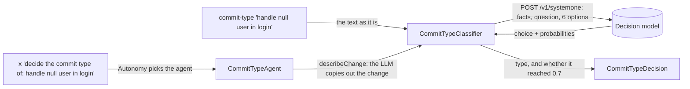

# Tutorial 30 — Decision model (a fixed choice, without an LLM)

Part of **`feat/all_together`** — see [TUTORIAL-INDEX.md](TUTORIAL-INDEX.md).

## What a decision model is

An LLM writes text. A decision model only **picks**. You give it:

- some facts (the *state*),
- one question,
- a fixed list of options, each described in one sentence.

It gives back one of your options, plus a probability for every option. It runs on a CPU in
about a second, and the same input always gives the same answer. It never writes free text, so
your code can use the answer as it is.

```text
question:  What kind of change does this commit make?
facts:     {"change": "handle null user in login"}
options:   feat, fix, docs, refactor, test, chore   (one sentence each)

answer:    fix 0.87 | feat 0.11 | test 0.02 | chore 0.00 | docs 0.00 | refactor 0.00
```

## The example: pick a commit's type

[Conventional Commits](docs/COMMIT_CONVENTIONS.md) allows six types. That is a fixed list, so it
suits a decision model. There are two ways in:



- **`commit-type`** sends your text straight to the decision model. No LLM is involved.
- **`x`** goes through an agent of two steps. First the LLM copies the change out of your
  sentence. Then the decision model picks the type. See [the first lesson](#lessons) for why
  the first step is needed.

## Run a decision model

This uses [Von](https://github.com/wfzyx/von) (Apache-2.0). Its repository was archived in
October 2026, but the image and weights are still published.

```bash
docker run --rm -p 8000:8000 -v von-hf:/data/huggingface ghcr.io/wfzyx/von:cpu
```

- The first request downloads about 3 GB of weights into the `von-hf` volume. Later starts reuse
  them.
- The image is `linux/amd64` only. On Apple Silicon, Docker runs it through Rosetta, which is
  slower.
- Any server that speaks `POST /v1/systemone` will do. Point `simple-demo.decision-model.url`
  at it.

Check it answers:

```bash
curl -s localhost:8000/v1/systemone -H 'content-type: application/json' -d '{"state":{"change":"handle null user in login"},"questions":{"q":{"type":"choice","instructions":"What kind of change does this commit make?","criteria":{"feat":"A new feature","fix":"A bug fix"}}}}'
```

## Try it

```bash
./mvnw spring-boot:run
```

Put the change in double quotes:

```text
embabel> commit-type "handle null user in login"
fix (0.87): confident, use it
  fix       0.87
  feat      0.11
  test      0.02
  chore     0.00
  docs      0.00
  refactor  0.00

embabel> commit-type "add unit tests for the price calculator"
unsure (0.55): the model leans to 'feat'. Pick the type yourself, or ask an LLM.
  feat      0.55
  test      0.45
  ...

embabel> x "decide the commit type of: handle null user in login"
```

The `x` run shows `LLMs used: [gemma4:e4b] across 1 calls`. That one call is the copying step;
the decision itself is not an LLM call.

## Key code

| File | Role |
|------|------|
| [`decision/DecisionModelClient.java`](src/main/java/com/example/simpledemo/decision/DecisionModelClient.java) | One HTTP call: facts, question and options in; choice and probabilities out |
| [`decision/CommitTypeClassifier.java`](src/main/java/com/example/simpledemo/decision/CommitTypeClassifier.java) | The six types, one sentence each, and the 0.7 bar |
| [`decision/CommitTypeDecision.java`](src/main/java/com/example/simpledemo/decision/CommitTypeDecision.java) | The answer, and how the shell prints it |
| [`agent/CommitTypeAgent.java`](src/main/java/com/example/simpledemo/agent/CommitTypeAgent.java) | The `x` path: LLM copies out the change, then the decision model decides |
| [`shell/DecisionShellCommands.java`](src/main/java/com/example/simpledemo/shell/DecisionShellCommands.java) | The `commit-type` command |
| [`CommitTypeClassifierTest`](src/test/java/com/example/simpledemo/decision/CommitTypeClassifierTest.java) | A mock server plays the model, so `./mvnw test` needs no Docker |

| Property | Default | Meaning |
|----------|---------|---------|
| `simple-demo.decision-model.url` | `http://localhost:8000` | Where the decision model listens |
| `simple-demo.decision-model.min-confidence` | `0.7` | Below this, the answer is reported as "unsure" |

## How well it does

I wrote 18 one-line changes, three for each type, and labelled them before asking (Von 1.3.0, on
CPU, 2 November 2026).

- **14 of 18 were right.**
- Every right answer scored 0.74 or more. Every wrong one scored 0.67 or less. So on these 18,
  the 0.7 bar caught every miss.
- It got two traps right that would fool a keyword rule: "fix typos in the API guide" is `docs`,
  and "make the flaky login test deterministic" is `test`.
- **18 examples is a small test.** Check the bar on your own examples before you rely on it.

<details>
<summary>All 18 answers</summary>

| Change | Expected | Answer | Probability |
|--------|----------|--------|-------------|
| add dark mode toggle to settings page | feat | feat | 0.81 |
| support exporting reports as CSV | feat | feat | 0.96 |
| let users reset their password by email | feat | feat | 0.98 |
| handle null user in login | fix | fix | 0.87 |
| stop the parser crashing on empty input | fix | fix | 0.93 |
| correct the timezone used in daily reports | fix | **test** | 0.62 |
| explain how to run the app with Docker in the README | docs | **chore** | 0.66 |
| fix typos in the API guide | docs | docs | 0.77 |
| document the retry settings | docs | docs | 0.93 |
| split the 400-line OrderService into smaller classes | refactor | refactor | 0.80 |
| rename getData to loadCustomer | refactor | refactor | 0.99 |
| extract the date parsing into a helper | refactor | **chore** | 0.67 |
| add unit tests for the price calculator | test | **feat** | 0.55 |
| cover the empty-cart case in checkout tests | test | test | 0.74 |
| make the flaky login test deterministic | test | test | 0.80 |
| bump spring-boot to 3.4.5 | chore | chore | 0.82 |
| run the build on Java 21 in CI | chore | chore | 0.93 |
| update the .gitignore for IntelliJ files | chore | chore | 0.98 |

</details>

## Lessons

- **It reads every word you send.** Sent whole, "decide the commit type of: handle null user in
  login" came back `test` at 0.83: wrong, and above the bar. "handle null user in login" alone
  came back `fix` at 0.87. Send only the facts. That is why `CommitTypeAgent` has the LLM copy
  out the change first.
- **The option sentences are the prompt.** Change one and the answers change. Treat them like
  code, and re-check them on labelled examples after every edit.
- **A high probability is not proof.** The wrong `test` above scored 0.83.
- **It can only pick from your list.** It has no way to say "none of these". If some inputs fit
  no option, filter them out before you ask.
- **Try plain code first.** If a keyword list can read the answer straight from the text, it is
  simpler and often as good. A decision model earns its place where the meaning matters more
  than the words, as with "fix typos" being `docs`.

| Good fit | Better done another way |
|----------|-------------------------|
| A fixed list of options | An open answer: use an LLM |
| A short sentence whose meaning decides | An id or a name that says the answer: use code |
| Must run locally, cheaply, the same way every time | Needs many rules weighed together: use an LLM |
