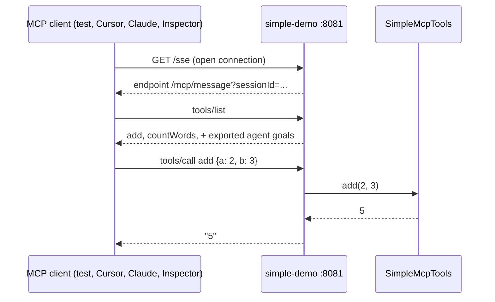

# Tutorial: the simplest MCP example

Two plain Java methods, published over MCP, called by a client. No LLM, no agent, no git.

Start here if [TUTORIAL-MCP.md](TUTORIAL-MCP.md) feels like a lot. That one needs Ollama, `npx` and full agents. This one needs only the app.

## What you get

| Tool | Input | Returns |
|------|-------|---------|
| `add` | `a`, `b` (whole numbers) | their sum |
| `countWords` | `text` | number of words |



## The code (three files)

| File | Role |
|------|------|
| [mcp/SimpleMcpTools.java](src/main/java/com/example/simpledemo/mcp/SimpleMcpTools.java) | The tools: methods marked `@LlmTool` |
| [mcp/SimpleMcpToolsConfiguration.java](src/main/java/com/example/simpledemo/mcp/SimpleMcpToolsConfiguration.java) | One `McpToolExport` bean, so the server publishes them |
| [mcp/SimpleMcpToolsTest.java](src/test/java/com/example/simpledemo/mcp/SimpleMcpToolsTest.java) | A real MCP client: connect, list, call |

The whole publishing step is one bean:

```java
@Bean
McpToolExport simpleMcpTools() {
  return McpToolExport.fromToolObject(new ToolObject(new SimpleMcpTools()));
}
```

Embabel's MCP server picks up every `McpToolExport` bean. It only runs on the `mcp-server` profile.

## Run the test

```bash
./mvnw test -Dtest=SimpleMcpToolsTest
```

The test starts the server on a random port, then calls `add(2, 3)` and expects `5`. No LLM is called.

**Note:** the app asks Ollama for its model list at startup, so start Ollama first.

## Run the server and call it yourself

```bash
SPRING_PROFILES_ACTIVE=mcp-server ./mvnw spring-boot:run
```

Look for `Tomcat started on port 8081` and `Exposing N tools`. Then check the endpoint:

```bash
curl -N http://localhost:8081/sse
```

You should see `event:endpoint` and a `/mcp/message?sessionId=...` line. Press Ctrl+C to stop curl.

Connect a client to `http://localhost:8081/sse`:

| Client | How |
|--------|-----|
| Claude Code | `claude mcp add --transport sse simple-demo http://localhost:8081/sse` |
| Cursor | `~/.cursor/mcp.json`, see [TUTORIAL-MCP.md](TUTORIAL-MCP.md#publish-mcp-profile-mcp-server) |
| MCP Inspector | `npx @modelcontextprotocol/inspector`, transport SSE, URL above |

Then ask the client to "add 2 and 3 using the simple-demo tools".

## Add your own tool

1. Add a method to `SimpleMcpTools` with `@LlmTool(description = "...")`.
2. Describe each argument with `@LlmTool.Param`.
3. Restart. The method name becomes the tool name.

<details>
<summary>Why the <code>mcp-server</code> profile needs <code>ShellWebModeEnvironmentPostProcessor</code></summary>

The Embabel shell starter sets `spring.main.web-application-type` from `embabel.agent.shell.web-application-type` (default `none`). It does this with top priority and before profile files are read. So `spring.main.web-application-type=servlet` in a profile file had no effect, and port 8081 never opened.

[ShellWebModeEnvironmentPostProcessor.java](src/main/java/com/example/simpledemo/config/ShellWebModeEnvironmentPostProcessor.java) runs right after profile files are read. It applies `embabel.agent.shell.web-application-type` from the profile. [application-mcp-server.properties](src/main/resources/application-mcp-server.properties) sets it to `servlet`.

</details>

<details>
<summary>Harmless log line at startup</summary>

```text
ERROR NonInteractiveShellRunner - In non interactive mode, it expected to have at least one argument: the command to execute or the script file
```

Spring Shell 4 logs this when the app starts with no shell command. The MCP server keeps running.

</details>
